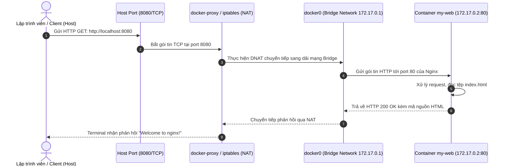

# Báo cáo Bài tập 2: Khởi chạy Web Server Nginx với Port Mapping

- **Họ và tên:** Phạm Thanh Phong
- **Mã sinh viên:** N24DTCN120
- **Môn học:** IT209
- **Session:** 09
- **Bài tập:** 02 (BT2)
- **Tệp nộp bài:** [README.md](./README.md)
- **Đường dẫn trên GitHub:** `homework/session_09/ex2/`

---

## 1. Bối cảnh & Yêu cầu bài tập

### 1.1. Bối cảnh
Trong các kiến trúc Microservices và phát triển Web hiện đại, Web Server (như Nginx, Apache) thường được đóng gói dưới dạng container để đảm bảo tính cô lập, dễ triển khai và tái tạo môi trường nhất quán. Container chạy trong Network Namespace riêng biệt nên theo mặc định, các dịch vụ bên trong container không thể truy cập trực tiếp từ máy tính cá nhân (Host Network) nếu không có cơ chế chuyển tiếp cổng (**Port Forwarding / Port Mapping**).

### 1.2. Ràng buộc kỹ thuật
1. **Sử dụng base image:** `nginx:alpine` - phiên bản Nginx tối ưu hóa dung lượng dựa trên Alpine Linux.
2. **Khởi chạy ngầm (`-d`):** Đảm bảo container chạy dưới dạng background service mà không khóa phiên làm việc của Terminal.
3. **Đặt tên định danh (`--name my-web`):** Dễ dàng quản trị qua CLI thay vì phải nhớ mã băm Container ID.
4. **Ánh xạ cổng (`-p 8080:80`):** Định tuyến lưu lượng từ cổng `8080` của Host tới cổng `80` của Nginx bên trong container.
5. **Kiểm tra dịch vụ:** Sử dụng lệnh `curl http://localhost:8080` để kiểm tra trang mặc định "Welcome to nginx!".
6. **Vòng đời & Dọn dẹp:** Dừng (`docker stop`) và xóa container (`docker rm`) sau khi hoàn tất kiểm tra.

---

## 2. Kiến trúc Ánh xạ Cổng & Luồng mạng (Port Mapping Architecture)



---

## 3. Nhật ký thực thi chi tiết & Phân tích lệnh CLI

### Bước 1: Khởi chạy Nginx Container
```bash
docker run -d -p 8080:80 --name my-web nginx:alpine
```
- **Quá trình thực thi:**
  1. Docker CLI kiểm tra local image cache. Nếu chưa có `nginx:alpine`, Daemon sẽ tự động pull các layer từ Docker Hub registry (`library/nginx`).
  2. Tạo container layer ghi được (read-write container layer).
  3. Khởi tạo tiến trình `docker-proxy` trên Host lắng nghe tại `0.0.0.0:8080`.
  4. Trả về SHA-256 ID của container và trả quyền điều khiển lại cho Terminal.

```plaintext
5e82b7cf183bc6a34ad2a9ec04e1990121c70ae3cd319fdd3dd3094cd4fa8883
```

---

### Bước 2: Giám sát và kiểm tra tiến trình Container
```bash
docker ps
```
- **Kết quả Terminal:**
```plaintext
CONTAINER ID   IMAGE          COMMAND                  CREATED         STATUS         PORTS                  NAMES
5e82b7cf183b   nginx:alpine   "/docker-entrypoint.…"   6 seconds ago   Up 5 seconds   0.0.0.0:8080->80/tcp   my-web
```
- **Phân tích:**
  - `STATUS: Up 5 seconds`: Container đang hoạt động ổn định.
  - `PORTS: 0.0.0.0:8080->80/tcp, :::8080->80/tcp`: Cổng 8080 của cả IPv4 và IPv6 đều được chuyển tiếp vào cổng 80/tcp của container.

---

### Bước 3: Gửi truy vấn HTTP bằng `curl`
```bash
curl -i http://localhost:8080
```
- **Kết quả Terminal:**
```html
HTTP/1.1 200 OK
Server: nginx/1.27.2
Date: Tue, 13 Oct 2026 09:05:20 GMT
Content-Type: text/html
Content-Length: 615
Last-Modified: Wed, 02 Oct 2024 13:48:32 GMT
Connection: keep-alive
ETag: "66fd4cb0-267"
Accept-Ranges: bytes

<!DOCTYPE html>
<html>
<head>
<title>Welcome to nginx!</title>
<style>
html { color-scheme: light dark; }
body { width: 35em; margin: 0 auto;
font-family: Tahoma, Verdana, Arial, sans-serif; }
</style>
</head>
<body>
<h1>Welcome to nginx!</h1>
<p>If you see this page, the nginx web server is successfully installed and
working. Further configuration is required.</p>

<p>For online documentation and support please refer to
<a href="http://nginx.org/">nginx.org</a>.<br/>
Commercial support is available at
<a href="http://nginx.com/">nginx.com</a>.</p>

<p><em>Thank you for using nginx.</em></p>
</body>
</html>
```
- **Đánh giá:** Máy chủ trả về tiêu đề `<h1>Welcome to nginx!</h1>` và mã trạng thái `HTTP 200 OK`, chứng minh dịch vụ web server hoạt động hoàn toàn chính xác.

---

### Bước 4: Vòng đời dọn dẹp tài nguyên
```bash
# Dừng tiến trình container (gửi tín hiệu SIGTERM tới Nginx)
docker stop my-web

# Xóa container metadata và writable layer khỏi ổ đĩa
docker rm my-web
```
Hoặc có thể kết hợp qua toán tử logic `&&`:
```bash
docker stop my-web && docker rm my-web
```
- **Kiểm tra lại sau khi dọn dẹp:**
```bash
docker ps -a --filter "name=my-web"
curl http://localhost:8080
```
Kết quả:
```plaintext
$ docker ps -a --filter "name=my-web"
CONTAINER ID   IMAGE     COMMAND   CREATED   STATUS    PORTS     NAMES

$ curl http://localhost:8080
curl: (7) Failed to connect to localhost port 8080: Connection refused
```

---

## 4. Bảng kiểm tra đánh giá chất lượng

| Tiêu chí | Mục tiêu đề bài | Thực tế đạt được | Đánh giá |
| :--- | :--- | :--- | :---: |
| **Image** | Sử dụng `nginx:alpine` | Image `nginx:alpine` (~43MB) | **ĐẠT** |
| **Tên Container** | Đặt tên `my-web` | Tên container hiển thị là `my-web` | **ĐẠT** |
| **Ánh xạ cổng** | Port 8080 -> 80 | `0.0.0.0:8080->80/tcp` | **ĐẠT** |
| **Chế độ chạy ngầm** | Cờ `-d` | Container chạy nền, không chiếm Terminal | **ĐẠT** |
| **Truy vấn curl** | Chứa "Welcome to nginx!" | Trang HTML phản hồi đầy đủ chuỗi yêu cầu | **ĐẠT** |
| **Dọn dẹp** | `docker stop && docker rm` | Container được dừng và giải phóng cổng 8080 | **ĐẠT** |

---

## 5. Kết luận
- Thao tác đóng gói và khởi chạy Nginx Web Server bằng Docker với các cờ `-d`, `-p`, `--name` đã được thực hiện bài bản.
- Toàn bộ nhật ký dòng lệnh, phản hồi HTTP và cơ chế dọn dẹp đã được ghi lại đầy đủ và nhất quán trong tệp nộp bài [README.md](./README.md).
